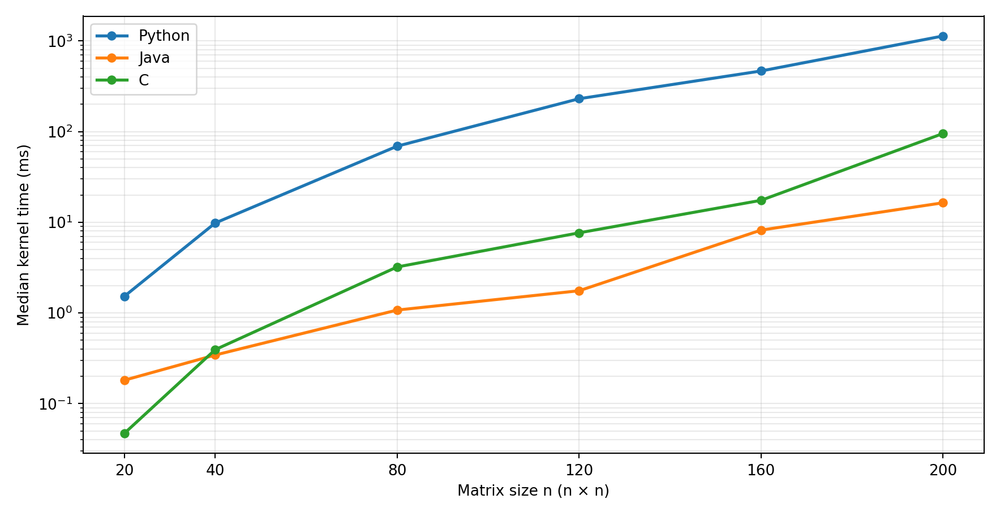
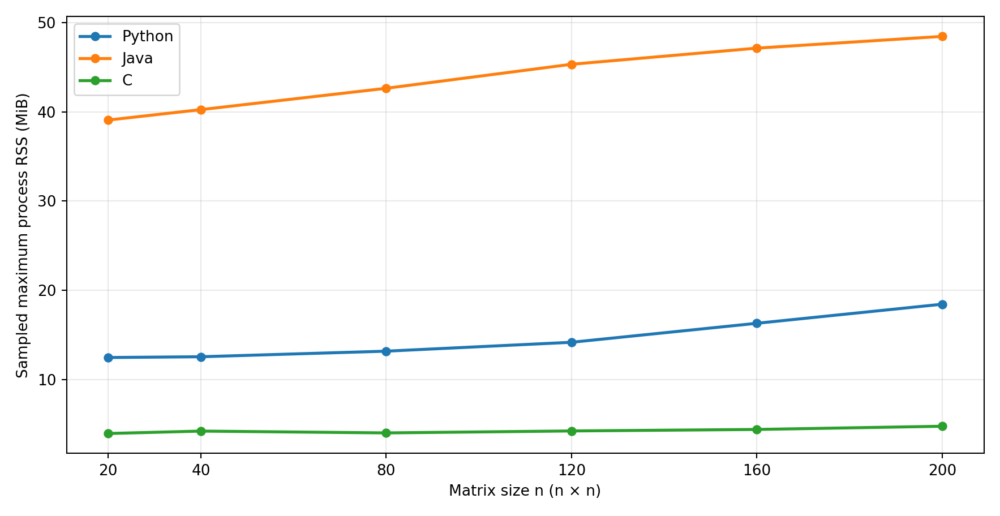

# Assignment 1: Basic Matrix Multiplication in Python, Java and C

**Student:** [ADD YOUR FULL NAME]  
**Course:** Big Data, Universidad de Las Palmas de Gran Canaria (2026/2027)  
**Repository:** [ADD YOUR GITHUB REPOSITORY LINK]  
**Date of experiment:** 16 October 2026

## Abstract

I compared basic matrix multiplication in Python, Java and C. My question was how the matrix size changes execution time and memory use. I used the same matrices and the same three-loop algorithm in each language. I tested six sizes, from 20 × 20 to 200 × 200, with five measured repetitions for each configuration. For the largest matrices, the median time was 1133.83 ms in Python, 16.41 ms in Java and 95.21 ms in C. Java was the fastest at this size, while C used the least process memory. The results describe these specific programs on my laptop, not a universal ranking of programming languages.

## 1. Introduction and objective

The aim of this experiment was to see how basic matrix multiplication behaves when the matrices get larger. I also wanted to compare the three implementations under similar conditions. My research question was: **How does matrix size affect execution time and process memory usage in Python, Java and C?**

Before running the tests, I expected execution time to increase strongly with matrix size because the basic algorithm has cubic complexity. I also expected the memory measurements to differ because the three languages store data and run programs differently.

## 2. Background

To multiply two square matrices A and B of size n × n, each element of the result C is calculated as **C[i,j] = sum(A[i,k] × B[k,j])** for k from 0 to n - 1. The straightforward algorithm uses three nested loops: one for rows, one for columns and one for the products added together. This needs approximately **O(n³)** arithmetic operations. The number of elements in a dense matrix grows as **O(n²)** [1].

I implemented the loops directly instead of using NumPy or another optimized matrix multiplication function. This made it easier to compare the same basic method in all three languages.

## 3. Methodology

### Programs and inputs

I used Python 3.12.4, Java 21 and C compiled with GCC 16.1.0. All implementations used an **i-j-k** loop order. Python stored matrices as lists of lists, Java used `long[][]`, and C used contiguous `int64_t` arrays. Python integers have arbitrary precision, while Java and C used 64-bit signed integers. With the values and sizes in this experiment, integer overflow was not an issue.

I generated square matrices of sizes **20, 40, 80, 120, 160 and 200**. Every element was an integer from 0 to 9. The generator was Python `random.Random`, using the seed **20261016 + n**. I saved the inputs to files, and each implementation read the same logical matrices for each size.

### Computer and measurements

The experiment ran on **Windows 11**, using an **Intel Core i5-10210U (4 physical cores, 8 logical processors)** with **7.72 GiB RAM**. C was compiled with `-std=c11 -O0 -Wall -Wextra`. Java ran with its normal JVM settings, including JIT compilation. There were **two warm-up runs**, followed by **five timed repetitions** per language and size. Warm-ups were not included in the reported results.

For time, I measured one multiplication call, including allocation and initialization of the result matrix. Reading input and writing output were outside the timer. The programs used `perf_counter_ns` (Python), `System.nanoTime` (Java) and `QueryPerformanceCounter` (C on Windows) [2]-[4]. I report the **median** and the **interquartile range (IQR)** in milliseconds.

For memory, a separate Python process checked each program's **resident set size (RSS)** about every 2 ms using psutil [5]. I report the highest observed value, in MiB. This measurement covers the **whole process**, including runtime start-up and file operations. It is not the same as memory used only by the matrix arrays. Each language/size was run as one process, so the memory figure is one observed maximum, not five independent measurements.

Before collecting results, the programs passed a known 2 × 2 example, an identity matrix test and a zero matrix test. I also compared every output element with an independent Python reference. I set a limit of **90 seconds and 1024 MiB per process**. No failures were recorded in these tests.

## 4. Results

### Execution time

The table gives **median time in milliseconds**, followed by the **IQR** in brackets. Each entry uses five measured repetitions.

| n | Python (ms) | Java (ms) | C (ms) |
|---:|---:|---:|---:|
| 20 | 1.52 (0.264) | 0.18 (0.011) | 0.05 (0.012) |
| 40 | 9.82 (1.074) | 0.34 (0.034) | 0.39 (0.005) |
| 80 | 69.10 (7.678) | 1.08 (0.004) | 3.22 (0.574) |
| 120 | 230.55 (26.252) | 1.76 (0.757) | 7.66 (0.203) |
| 160 | 466.37 (28.358) | 8.20 (0.647) | 17.47 (0.836) |
| 200 | 1133.83 (242.159) | 16.41 (6.155) | 95.21 (2.708) |

**Figure 1.** Median multiplication time for each matrix size. The vertical axis uses a logarithmic scale so the three lines can be seen clearly. The exact IQR values are in the table above.

The time increased as the matrices became larger. At n = 200, Python took around **1.13 seconds**, compared with **16.41 ms for Java** and **95.21 ms for C**. Java was about **69 times faster than Python** at this size in my measurements. I did not expect C to be slower than Java, so the compiler settings matter when interpreting this result.

### Process memory

The table shows the **maximum RSS observed during each process**, in MiB. This includes the language runtime and file operations.

| n | Python (MiB) | Java (MiB) | C (MiB) |
|---:|---:|---:|---:|
| 20 | 12.46 | 39.08 | 3.95 |
| 40 | 12.55 | 40.25 | 4.22 |
| 80 | 13.18 | 42.64 | 4.02 |
| 120 | 14.17 | 45.33 | 4.23 |
| 160 | 16.30 | 47.14 | 4.40 |
| 200 | 18.44 | 48.45 | 4.76 |

**Figure 2.** Maximum sampled process RSS for each language and matrix size.

At n = 200, the observed values were **18.44 MiB for Python**, **48.45 MiB for Java** and **4.76 MiB for C**. C had the smallest process memory measurement for every tested size. Java had the highest, mainly reflecting the larger runtime environment as well as the data structures.

## 5. Discussion and limitations

The increasing execution times are consistent with the **O(n³)** prediction, although the real results do not follow a perfect cubic curve. For example, when n went from 40 to 80, the Python median increased from **9.82 ms to 69.10 ms** (about **7 times**). This is close to the theoretical factor of 8 when the side length doubles. At other sizes the ratio was different, which is normal because timing also depends on the computer, caching, and runtime behaviour.

Python was the slowest in these tests. One possible explanation is the overhead of running nested loops and handling integer objects in the interpreter. Java performed very well at larger sizes, possibly helped by JVM JIT compilation. C used native code and less process memory. However, **I compiled C with `-O0`, meaning compiler optimization was disabled**, while Java used a JIT compiler. Therefore, this is not a fair test of the maximum performance each language can reach. It is a comparison of the versions and settings that I actually used.

The memory results need a separate interpretation. RSS measures the process, not only the arrays, and the three programs have different runtime and storage costs. Also, memory was sampled approximately every 2 ms, so a very short peak could be missed. The computer could have had background tasks running, and the JVM was not configured with specific garbage-collector or processor-affinity settings. The experiment only covers sizes up to 200 and one laptop.

## 6. Conclusion

My experiment shows that larger matrices require much more time with the basic three-loop multiplication algorithm. All three programs produced correct results, and **200 × 200 was the largest size I tested successfully**, with no reported timeouts or memory-limit failures. For n = 200, Java had the lowest median time and C had the lowest observed process RSS. I cannot conclude that Java is always faster than C or that Python always uses more memory in every matrix multiplication program. Different compiler options, algorithms or larger matrices could change the results.

## References

[1] Universidad de Las Palmas de Gran Canaria, *Individual Assignments: Matrix Multiplication*, Big Data, 2026–2027, pp. 2–4, 8–9.  
[2] Python Software Foundation, *time — Time access and conversions*, Python 3.12 documentation. https://docs.python.org/3.12/library/time.html  
[3] Oracle, *System.nanoTime*, Java SE 21 API documentation. https://docs.oracle.com/en/java/javase/21/docs/api/java.base/java/lang/System.html  
[4] Microsoft, *QueryPerformanceCounter function*, Microsoft Learn. https://learn.microsoft.com/en-us/windows/win32/api/profileapi/nf-profileapi-queryperformancecounter  
[5] psutil documentation, *Process.memory_info / RSS*. https://psutil.readthedocs.io/en/latest/  

## Reproducibility and AI assistance

The repository contains the Python, Java and C source files, `run_experiments.py`, the plotting script, the raw CSV measurements, the environment details and the README. To reproduce the experiment, run `python -m pip install -r requirements.txt`, followed by `python run_experiments.py`.

**AI assistance:** I used ChatGPT to help plan the experiment, prepare and debug the scripts, and edit the English in this report. The measurements reported here come from runs on my own computer. I am responsible for reviewing the code, checking the results and explaining the project during the oral defence.
